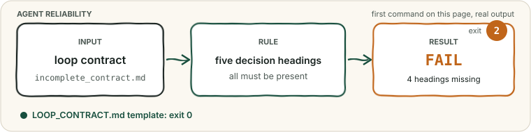

# loop-contract

**An agent loop that stops only when the model feels done can run up costs or ship broken work, because nothing outside the model checks the result.**

[](https://github.com/homayoun-safarpour/agent-loop-field-guide/actions/workflows/ci.yml)


Agent reliability: a five-decision Loop Contract to fill before you automate an agent loop, with a heading checker (exit 0 or 2).

loop-contract is a field guide, a blank contract and a small checker for anyone about to run an AI agent in a loop, such as a `/loop`, a cron job or an autonomous coding agent. We built it because a loop that stops only when the model feels done can waste money or ship broken work, and the sources in the guide agree that done must be a check a machine can run. Given a contract file, `check_contract.py` looks for the five decision headings and returns exit 0 when all are present, or exit 2 with the missing ones, so that a CI job can stop before the loop starts.

```bash
git clone https://github.com/homayoun-safarpour/agent-loop-field-guide
cd agent-loop-field-guide && python scripts/check_contract.py examples/incomplete_contract.md
```

```text
FAIL: missing headings:
  - ## 2. Verifier
  - ## 3. Stop layers
  - ## 4. State file
  - ## 5. Irreversible
```

That command exits 2. The same check on `templates/LOOP_CONTRACT.md` exits 0. There is nothing to pip install, because the checker uses only the Python standard library.



[How it works](#how-it-works) · [Results](#what-each-result-means) · [Limits](#limits) · [Interview pack](docs/INTERVIEW.md) · [Cite](#citation) · Part of [a small open stack for checking AI agents and their judges](https://homayoun-safarpour.github.io)

## What each result means

| Output | Exit | Meaning |
|---|---|---|
| `PASS: <file> has all five Loop Contract headings` | 0 | All five decision headings appear in the file. |
| `FAIL: missing headings:` and a list | 2 | One or more of the five headings is missing, and each missing one is listed. |
| `not a file: <path>`, or the usage line, on stderr | 1 | The path is not a file, or the command did not get exactly one argument. |

A `PASS` shows that the contract has all five sections. It does not show that the answers under them are written or sound, because the blank template with its empty cells passes as well.

## Use this when

| Situation | Use this guide? |
| --- | --- |
| You are about to schedule `/loop`, a cron job or an autonomous coding agent | Yes. Fill the contract first |
| You want the five decisions (done, verifier, stop layers, state file, irreversible actions) written down on disk | Yes |
| You want CI to fail when a project's contract is missing a section | Yes. Run `check_contract.py` on that file |
| You want the checker to judge whether the answers are good | No. Compare your copy with [`templates/sample_filled.md`](templates/sample_filled.md) and ask someone who did not write it to review it |
| You want a runnable decision policy in Python | No. Use [agent-loop-engine](https://github.com/homayoun-safarpour/agent-loop-engine) |

## The problem

Long work fails when the only memory is a chat window and the only stop condition is the model's own sense of being finished. The sources in the guide agree that done has to be a signal a machine can check (a command, an exit code or a score), and that the check should not come from the same agent that did the work. In addition, a loop needs several stop rules together, a state file on disk so that a crash can resume, and a human yes before anything that cannot be undone. The contract asks for these five decisions before the loop runs.

## How it works

1. Copy the blank contract into your project and fill in each section.
2. Run the checker on your copy. It exits 0 when the five headings are there and 2 when any is missing.
3. Put the same command in CI, as this repo does for its own template in [`.github/workflows/ci.yml`](.github/workflows/ci.yml).

```bash
cp templates/LOOP_CONTRACT.md ../YOUR_PROJECT/LOOP_CONTRACT.md
python scripts/check_contract.py templates/sample_filled.md
```

```text
PASS: templates/sample_filled.md has all five Loop Contract headings
```

On Windows the path in that line prints with backslashes, and `Copy-Item` takes the place of `cp`.

The five decisions:

1. **Done**: an objective signal that means finished (a command, an exit code or a score threshold).
2. **Verifier**: a check that did not produce the work.
3. **Stop layers**: a goal check, a cap on turns, a budget and a no-progress rule.
4. **State file**: a path on disk where progress lives.
5. **Irreversible**: the actions that need a human yes, such as a delete, a force-push or spending money.

| Path | What it holds |
| --- | --- |
| [docs/FIELD_GUIDE.md](docs/FIELD_GUIDE.md) | The rules that the five sources share, the loop types, anti-patterns and the link to agent-loop-engine |
| [templates/LOOP_CONTRACT.md](templates/LOOP_CONTRACT.md) | The blank five-decision contract |
| [templates/sample_filled.md](templates/sample_filled.md) | A filled contract for an agent-loop-engine backlog |
| [templates/sample_ci_triage.md](templates/sample_ci_triage.md) | A filled contract for a CI failure and pull-request triage loop |
| [scripts/check_contract.py](scripts/check_contract.py) | The heading checker (exit 0, 2 or 1) |
| [examples/incomplete_contract.md](examples/incomplete_contract.md) | A contract with four headings missing, which exits 2 |

Interview pack: [docs/INTERVIEW.md](docs/INTERVIEW.md), five points tied to commands. The limits of each claim are in [docs/RELIABILITY_CARD.md](docs/RELIABILITY_CARD.md).

## Limits

- It is not a runtime or an agent framework. It runs no loop and carries out no action, whereas [agent-loop-engine](https://github.com/homayoun-safarpour/agent-loop-engine) is the runnable companion.
- The checker matches the five heading lines as exact text anywhere in the file. A renamed heading such as `## 1. Definition of done` fails, and a heading inside a code block still counts.
- It does not read what is under a heading, so a contract with empty cells passes.
- A file that is not valid UTF-8 stops the checker with a Python error (exit 1) instead of a short message.
- The guide paraphrases five outside sources that are larger than it is. It extracts the rules they share and does not cover each one in full.
- It has no dependencies, and CI runs the tests on Python 3.10, 3.11 and 3.12. Each exit code has a named test under `tests/`.

## Use it with agent-loop-engine

The contract maps onto [agent-loop-engine](https://github.com/homayoun-safarpour/agent-loop-engine): Done and Verifier become the engine's gates (for example `pytest -q`), the state file is `LOOP_STATE.md`, and irreversible actions stay with a person or CI, because the engine prints the next step and does not execute it. [`templates/sample_filled.md`](templates/sample_filled.md) is that mapping written out.

## How we did it

1. **Read the sources.** We read Anthropic's posts on building agents and on loops, Simon Willison's essay on agentic loops, cobusgreyling/loop-engineering, and the Ralph and harness-engineering projects, and kept the rules they share ([docs/FIELD_GUIDE.md](docs/FIELD_GUIDE.md)).
2. **Wrote the contract.** We turned those rules into five decisions with fixed headings in `templates/LOOP_CONTRACT.md`, and filled two samples (an agent-loop-engine backlog and a CI triage loop).
3. **Added the checker.** A standard-library script with three exit codes, each locked by a named test: `test_blank_contract_passes_check_script`, `test_truncated_contract_exits_2`, `test_missing_file_exits_1_with_stderr` and `test_readme_stranger_incomplete_contract_exits_2`.

## Related tools

- [agent-loop-engine](https://github.com/homayoun-safarpour/agent-loop-engine): state, gates, the next-step decision and a journal for agent loops.
- [judge-drift-sentinel](https://github.com/homayoun-safarpour/judge-drift-sentinel): tells a change in the system from a change in the judge.
- [trace-gate](https://github.com/homayoun-safarpour/trace-gate): fails CI when an agent's recorded run scores below a frozen baseline.
- [judge-field-guide](https://github.com/homayoun-safarpour/judge-field-guide): a link-checked map of tools for language-model judges.
- [ai-eng-skill-range](https://github.com/homayoun-safarpour/ai-eng-skill-range): graded exercises for the same skills.

## Credit

The ideas in the guide are synthesised from the linked Anthropic posts, Simon Willison's essay, the loop-engineering project and the Ralph and harness-engineering lineage. The wording is original. Upstream projects keep their own licences, and this repo links to them instead of copying their code. The full source list is in [docs/FIELD_GUIDE.md](docs/FIELD_GUIDE.md).

## Citation

Use the "Cite this repository" button on GitHub, which reads [`CITATION.cff`](CITATION.cff).

Author: Homayoun Safarpour. [LinkedIn](https://www.linkedin.com/in/homayoun-safarpour/)

## License

MIT. See [`LICENSE`](LICENSE).
